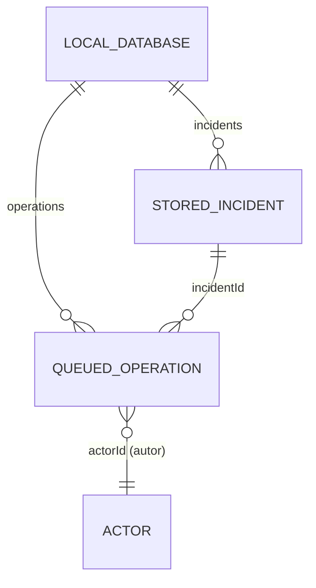

# CampusOps — Modelo de datos local (Semana 8)

Este documento describe qué guarda la app en el dispositivo, dónde lo guarda, con qué versión de esquema y cómo se migra y recupera. Todos los datos de ejemplo son ficticios y vienen del contrato público (`campus-inc-001`, `technician-1`, `technician-2`, `coordinator-1`).

Código relacionado:

| Archivo | Responsabilidad |
|---|---|
| `src/persistence/key-value-storage.ts` | Puerto `KeyValueStorage` (`getItem`, `setItem`, `removeItem`). |
| `src/persistence/async-storage-driver.ts` | Implementación en la app con `@react-native-async-storage/async-storage`. |
| `src/persistence/local-database.ts` | Esquemas 1 y 2, validación, migración, respaldo y recuperación. |
| `src/persistence/operation-queue.ts` | Cola persistente de operaciones sin conexión. |
| `src/sync/deduplicate-operations.ts` | Deduplicación por `operationId`; la usa la cola y el adaptador `deduplicateOperations`. |
| `tests/week-08/*.test.ts` | Pruebas de reinicio, migración, fallas inyectadas e identidad de operaciones. |

## 1. Almacenamiento elegido

**AsyncStorage** (`@react-native-async-storage/async-storage` 2.2.0, instalado con `npx expo install`). En Android guarda cada clave como una fila en una base SQLite propia de la app, por lo que reemplazar el valor de una clave es una escritura atómica: se ve el valor anterior completo o el nuevo completo.

Toda la base local vive en **un solo documento JSON** bajo una clave. Cada cambio reescribe el documento entero con un solo `setItem` (copy-on-write). Así nunca puede quedar, por ejemplo, la cola en esquema 2 y las incidencias en esquema 1.

| Clave | Contenido | Cuándo existe |
|---|---|---|
| `campusops.db` | Documento completo de la base (`schemaVersion`, `incidents`, cola). | Siempre después del primer arranque. |
| `campusops.db.backup` | Copia textual exacta del documento antes de migrar. | Sólo durante una migración. |
| `campusops.db.migration` | Marcador `{ from, to, startedAt }`. | Sólo durante una migración. Si existe al arrancar, la migración anterior se interrumpió. |

**Qué no se guarda aquí:** tokens de sesión, contraseñas ni encabezados `Authorization`. La sesión sigue las reglas de la semana 6 y vive aparte, en `expo-secure-store` (`src/auth/session-manager.ts`). Una prueba revisa que el documento persistido no contenga `token` ni `authorization`.

**Alternativas consideradas:**

- `expo-sqlite`: ofrece transacciones SQL reales, pero agrega un módulo nativo y su API no corre en Jest sin un doble de prueba, por lo que las pruebas de migración no tocarían el almacenamiento real.
- Lista en memoria: no sobrevive al reinicio, así que no cumple el requisito.

Con AsyncStorage, la atomicidad se consigue con el documento único más el respaldo y el marcador. El costo es reescribir todo el documento en cada cambio, lo cual es aceptable para el volumen de una cola de técnico (decenas de operaciones, no miles).

## 2. Entidades y relaciones



### `StoredIncident` (copia local del DTO del backend)

| Campo | Tipo | Regla |
|---|---|---|
| `id` | string | No vacío, por ejemplo `campus-inc-001`. |
| `version` | entero ≥ 0 | Versión del servidor cuando se guardó la copia. |
| `status` | `open`, `assigned`, `in_progress`, `resolved` o `closed` | Igual que el contrato. |
| `payload` | objeto o `null` | Copia del payload (incluye `assignedTechnicianId`). `null` es válido y no se rellena con datos inventados. |

### `QueuedOperation` (cambio pendiente)

Extiende `PendingIncidentOperation` de `src/campusops/contracts.ts`.

| Campo | Tipo | Para qué sirve |
|---|---|---|
| `operationId` | string (≥ 8 caracteres) | Identidad estable. Se envía como `Idempotency-Key`. No cambia al reiniciar, reintentar ni migrar. |
| `incidentId` | string | Incidencia afectada. |
| `baseVersion` | entero ≥ 0 | Versión que vio el autor al crear el cambio. Sirve como base común para detectar conflictos. |
| `actorId` | string | Autor del cambio (por ejemplo `technician-1`). |
| `action` | string | Acción del contrato: `start`, `comment`, `add_evidence`, `resolve`, etc. |
| `payload` | objeto | Contenido de la acción (por ejemplo `{ text }` o `{ evidenceId }`). |
| `createdAt` | ISO 8601 | Momento en que se encoló. |
| `state` | `pending` o `conflict` | `conflict` conserva la intención local hasta que se resuelva. |
| `attempts` | entero ≥ 0 | Intentos de envío fallidos o en conflicto. |
| `conflictFields` | string[] | Campos incompatibles en orden de nombre (por ejemplo `['work']`). |

**Fotografías pendientes:** una operación `add_evidence` guarda sólo la referencia (`evidenceId`, por ejemplo `photo-pending-001`, con `uploaded: false`). La referencia identifica un recurso que falta subir; no demuestra que la imagen ya esté en el servidor.

## 3. Versiones de esquema

**Esquema 1 (anterior):**

```json
{
  "schemaVersion": 1,
  "incidents": [{ "id": "campus-inc-001", "version": 1, "status": "assigned", "payload": { "assignedTechnicianId": "technician-1" } }],
  "pendingChanges": [
    { "localId": "1", "incidentId": "campus-inc-001", "actorId": "technician-1", "action": "start", "data": {}, "incidentVersion": 1 }
  ]
}
```

Los cambios sólo tenían un contador local (`localId`). No había identidad estable para usar como `Idempotency-Key`, ni estado de conflicto ni conteo de intentos.

**Esquema 2 (actual, `CURRENT_SCHEMA_VERSION = 2`):**

```json
{
  "schemaVersion": 2,
  "incidents": [{ "id": "campus-inc-001", "version": 1, "status": "assigned", "payload": { "assignedTechnicianId": "technician-1" } }],
  "operations": [
    {
      "operationId": "legacy-1", "incidentId": "campus-inc-001", "baseVersion": 1, "actorId": "technician-1",
      "action": "start", "payload": {}, "createdAt": "2026-10-23T18:00:00.000Z",
      "state": "pending", "attempts": 0, "conflictFields": []
    }
  ]
}
```

Transformación 1 → 2 (`migrateV1ToV2`):

| Esquema 1 | Esquema 2 |
|---|---|
| `localId` | `operationId = "legacy-" + localId` (determinista: repetir la migración da el mismo ID). |
| `incidentVersion` | `baseVersion` |
| `data` | `payload` |
| `actorId`, `action`, `incidentId` | Se copian igual. |
| — | `createdAt` (momento de migración), `state: 'pending'`, `attempts: 0`, `conflictFields: []`. |

Antes de escribir, la migración comprueba que no se perdieron registros: el número de incidencias y de operaciones debe ser igual al del esquema 1.

## 4. Cola persistente

`PersistentOperationQueue.open(storage)` abre la base (recupera, migra y valida) y carga la cola.

| Método | Efecto persistido |
|---|---|
| `enqueue(op)` | Agrega la operación. Si el `operationId` ya existe con el mismo contenido, devuelve la existente (no duplica). Si existe con contenido distinto, lanza `IdempotencyKeyReusedError` y no cambia nada. |
| `confirm(operationId)` | Único método que retira una operación; se usa sólo cuando el servidor confirmó. |
| `recordFailedAttempt(operationId)` | Timeout, error de red o 5xx: la operación sigue `pending` con la misma identidad y `attempts + 1`. |
| `markConflict(operationId, fields)` | Pasa a `conflict`, guarda los campos en orden de nombre y conserva la intención local. |
| `upsertIncident(incident)` | Actualiza la copia local de una incidencia. |

Las escrituras se encadenan (una termina antes de que empiece la siguiente), así que varios `enqueue` simultáneos no se pisan. Al abrir, la cola pasa por `deduplicateOperations`, que conserva la primera operación de cada `operationId` sin mutar la entrada.

## 5. Migración y recuperación

Procedimiento de `migrateDatabase` cuando encuentra el esquema 1:

1. Guarda la copia exacta en `campusops.db.backup`.
2. Escribe el marcador `campusops.db.migration`.
3. Transforma en memoria a esquema 2 y valida los conteos.
4. Reemplaza `campusops.db` con un solo `setItem`.
5. Borra el marcador y el respaldo.

**Si algo falla en los pasos 3 a 5** (error de transformación o de escritura), restaura `campusops.db` desde el respaldo, borra marcador y respaldo, y devuelve `{ status: 'rolled-back' }`. La base queda exactamente igual que antes, con byte por byte el mismo contenido.

**Si la app se cierra a mitad** (no alcanza a ejecutar el rollback), en el siguiente arranque `openLocalDatabase` encuentra el marcador, restaura el respaldo y vuelve a migrar. Como el `operationId` migrado es determinista, la segunda migración produce las mismas identidades.

**Datos corruptos:** si `campusops.db` no es JSON válido o no cumple ningún esquema, se lanza `CorruptDatabaseError` y no se sobrescribe, para no destruir información que se podría recuperar.

## 6. Cómo se comprueba

```bash
npx jest --no-watchman --ci --runInBand tests/week-08
```

| Prueba | Caso |
|---|---|
| `persistent-queue.test.ts` › restart keeps the same operation identity and content | Reinicio sin conexión: inicio de atención, nota y foto pendiente de `technician-1` sobreviven con el mismo `operationId` (almacenamiento en disco, instancia nueva). |
| `persistent-queue.test.ts` › persisted queue never stores session tokens | La cola no guarda secretos de sesión. |
| `persistent-queue.test.ts` › re-enqueueing the same operationId… | Misma identidad = un solo registro; misma clave con otro contenido = error. |
| `persistent-queue.test.ts` › only confirmed operations leave the queue… | Sólo `confirm` retira; fallo y conflicto se conservan tras reiniciar. |
| `persistent-queue.test.ts` › concurrent enqueues are serialized… | No se pierden escrituras simultáneas. |
| `migration.test.ts` › valid migration… | Migración 1 → 2 conserva incidencias y operaciones. |
| `migration.test.ts` › failure injected at … | Falla en cada paso: estado antes = estado después de la falla; reintento migra completo. |
| `migration.test.ts` › I/O failure while writing… | Error de escritura: el esquema 1 queda intacto. |
| `migration.test.ts` › app killed … is recovered on the next start | Cierre a mitad de migración: el siguiente arranque recupera y migra sin mezclar esquemas. |
| `migration.test.ts` › corrupt local data… | Datos corruptos se reportan y no se sobrescriben. |

La sincronización con el servidor (`SyncEngine.sync()`: envío con `Idempotency-Key`, detección de conflicto con `resolveSync` y uso de `confirm`, `recordFailedAttempt`, `markConflict`, `rebase` y `dismissConflict`) se documenta en `docs/sync-policy.md`.
